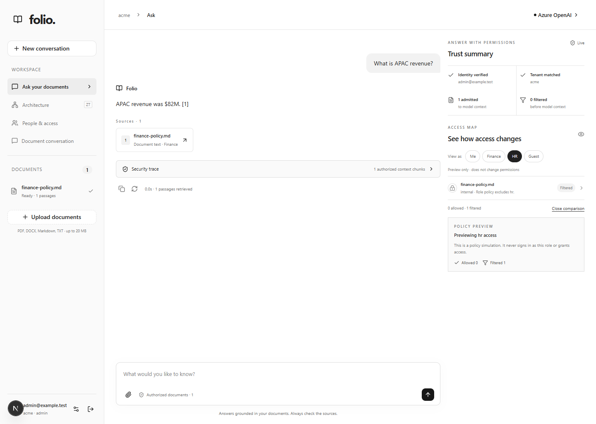
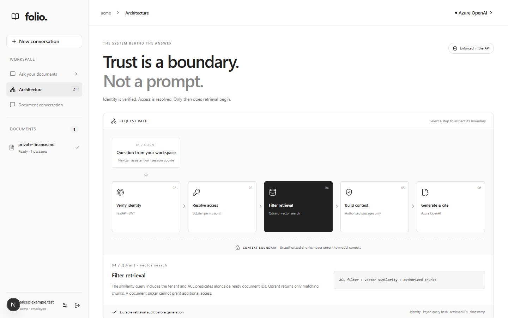
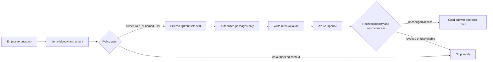

# Folio / Zero-Trust RAG

Folio is a local reference application for document Q&A with tenant and document permissions, source citations, and an access trace. Access is checked before retrieval and rechecked during a request; detected revocations suppress the result. The model does not decide who can read a document.





## The business case

- **Reduce disclosure risk:** private documents are removed before the model sees context.
- **Increase answer confidence:** every answer includes citations, source excerpts, and a security trace.
- **Make access explainable:** managers can see why a document was allowed or filtered without exposing hidden document names.

## Measured results

| Evaluation | Recorded result | Scope |
| --- | --- | --- |
| Permission suite | 40/60 → 60/60 cases pass | Real API/auth/SQLite/Qdrant with a deterministic provider and forced revocation interleavings. |
| Unauthorized responses among denial cases | 20/47 → 0/47 | Checks context, responses, IDs, filenames and content routes in the defined suite. |
| Incorrect denials among authorized cases | 0/13 before and after | Authorized access remains useful in the tested matrix. |
| SciFact: Azure `text-embedding-ada-002` + Qdrant | nDCG@10 **0.7292**, Recall@10 **0.8459** | Full corpus: 5,183 documents, 300 test queries. |
| SciFact: independent BM25 reference | nDCG@10 **0.6617**, Recall@10 **0.7909** | Same corpus and relevance judgments; a lexical comparison, not a before/after product change. |
| Azure `gpt-6-luna` answer smoke test | **20/20** expected-value and citation checks | 20 authored questions on one fictional document. Original literal matching is 16/20; equivalent numeric formats are accepted by the value matcher. |

The public retrieval benchmark ranks an isolated, entirely authorized corpus with one passage per document; it omits always-true policy filters and checks five queries against production filtered search. It does not measure the full ingestion/chunking pipeline, permission quality, or production filter latency. Answer value/citation hits do not establish claim entailment. These results do not establish superiority over competing products or universal security.

```sh
uv run python -m scripts.benchmark_permissions --output benchmark-output/permissions.json --gate
uv run python -m scripts.benchmark_answers --output benchmark-output/answers.json --gate
```

The permission run needs no Azure credentials. The answer run uses your configured Azure deployments. See [benchmark setup, raw reports, scoring limits and CI gates](benchmarks/README.md).

## Product direction and priorities

The proposed customer is a SaaS team embedding document answers into its own application. The goal is an **embeddable permission and evidence layer with measurable source-permission freshness and replayable access decisions**. A stable SDK, external identity integration and source ACL synchronization are planned; the current reference app uses its local accounts and document policies.

Permission-aware search and revocation testing already exist in enterprise products; [Glean documents tests for identity changes, source permissions, caches, citations and sync timing](https://www.glean.com/perspectives/how-do-you-test-ai-search-permissions-after-an-employee-changes-teams). Our hypothesis is that application teams will value easier embedding into their own stack and independently inspectable evidence. Integration effort and customer outcomes must be measured before claiming an advantage.

| Priority | Planned improvement | Proof that it helps |
| --- | --- | --- |
| 1 | Add a stable retrieval/answer SDK, managed identity integration, and one real source connector, starting with SharePoint/Entra ID. Preserve inherited ACLs, direct shares, groups, guests and deletion events. | A pilot team embeds it without manually recreating document permissions; compare integration time with its current approach. |
| 2 | Track source permission versions, policy observation times, cache invalidation and decision reasons. Export access-decision records that a customer can replay. | Measure source-change-to-enforcement p50/p95/p99 and worst observed delay; exercise stale ACLs, outages, in-flight revocation and deletion. Publish the supported freshness contract and test authorized access alongside denials. |
| 3 | Check support for individual answer claims, especially amounts, percentages and dates. Abstain or remove unsupported claims. | Human-reviewed held-out questions show better supported-claim precision while preserving useful answers; measure false abstentions separately. A valid citation number alone is insufficient. |
| 4 | Compare dense retrieval, lexical+dense hybrid search and reranking. Apply tenant/ACL checks before every retrieval branch and before any external reranker receives passages. | Improve retrieval on training data, then evaluate untouched SciFact and a second corpus, while preserving the permission gate. Report answer quality, latency and cost as well as nDCG/Recall. |
| 5 | Add production metadata storage, managed vector storage, durable ingestion workers, retries and deletion propagation. | Restart/load/connector-failure tests demonstrate recovery, bounded policy staleness and continued tenant isolation. |

The next useful demo is an employee losing access in SharePoint while a question is running: show when the source change is observed, which policy version each gate used, what context was sent while authorized, and why the response was withheld. Pair it with an authorized user who still gets a supported answer.

The next evaluation should use a larger independently reviewed user/tenant/source matrix and held-out answer questions, including unanswerable and malicious-document cases. Compare against the same model with a standard RAG pipeline and any commercial option actually available to the pilot team, under comparable permissions, data and budgets. Report leaks, false denials, supported claims, integration effort, latency and cost separately. [RAGBench](https://github.com/rungalileo/ragbench) and [BIPIA](https://github.com/microsoft/BIPIA) are planned evaluation inputs; neither score is claimed here.

## The architecture gate



The gate is the product boundary:

```text
tenant AND (owner OR role OR explicit user)
```

This rule is applied in the API and Qdrant before generation. Azure OpenAI never decides who can read a document. If the gate returns no supporting passages, Folio does not call the model.

## How it works

1. A person signs in; current tenant and roles are loaded from SQLite.
2. An administrator uploads a document and assigns roles or specific people.
3. Chunks inherit the document policy when they are indexed in Qdrant.
4. A question runs through the policy gate before similarity search.
5. Access is rechecked before generation and before release; detected changes suppress the result.
6. The answer is generated from authorized passages and returned with citations.
7. The inline **Trust summary** and **Access Map** show the decision beside the answer.

## Run locally

Requires Python 3.11–3.13, [uv](https://docs.astral.sh/uv/getting-started/installation/), Node.js 20.9+, and Azure OpenAI chat and embedding deployments.

```powershell
uv sync --locked
if (-not (Test-Path .env)) { Copy-Item .env.example .env }
```

Fill in `.env` locally:

```dotenv
AZURE_OPENAI_ENDPOINT=https://YOUR-RESOURCE.openai.azure.com
AZURE_OPENAI_API_KEY=YOUR_KEY
AZURE_OPENAI_CHAT_DEPLOYMENT=YOUR_CHAT_DEPLOYMENT
AZURE_OPENAI_EMBEDDING_DEPLOYMENT=YOUR_EMBEDDING_DEPLOYMENT
```

Start the API:

```powershell
uv run uvicorn backend.main:app --host 127.0.0.1 --port 8000
```

In another terminal:

```powershell
cd frontend
npm.cmd ci
npm.cmd run dev -- --port 3001
```

Open [http://127.0.0.1:3001](http://127.0.0.1:3001). Complete first-run setup, upload `examples/quarterly-report.md`, wait for **Ready**, and ask “What was APAC revenue?”.

Qdrant uses `.data/qdrant` by default. Run one local API process because embedded Qdrant locks its directory.

## Trust and storage

- JWT sessions are revocable and roles are reloaded on every request.
- SQLite stores accounts, document metadata, sessions, and audit records.
- Qdrant stores vectors with inherited tenant and ACL fields.
- Azure OpenAI provides embeddings and grounded answer generation.
- Uploads, the manifest, and vectors stay under `.data` and are ignored by Git.

## Current boundaries

This is a local reference application. PostgreSQL, managed SSO, source ACL synchronization, a stable application SDK, durable workers, reranking, persisted chat, and live Azure browser coverage are future work. Citation checks verify that references exist; they do not prove every claim is factually supported. A change after the final access check still races with delivery, and context already sent while authorized cannot be recalled. See [ARCHITECTURE.md](ARCHITECTURE.md) for the detailed policy and security limits.

## Verify changes

```powershell
uv run pytest -q
uv run ruff check backend tests scripts
cd frontend
npm.cmd run typecheck
npm.cmd run build -- --webpack
npm.cmd run test:e2e
```

Browser tests use isolated SQLite/Qdrant and a deterministic Azure test provider; they do not establish live Azure behavior.

## Repository map

| Area | Purpose |
| --- | --- |
| `backend/security.py` | Identity, sessions, roles, password hashing, and policy checks |
| `backend/main.py` | Upload, retrieval, audit, and API orchestration |
| `backend/ingestion.py` / `backend/parsing.py` | Parsing, chunking, embeddings, and indexing |
| `backend/vectors.py` | Qdrant storage and ACL filters |
| `frontend/src/components/workspace.tsx` | Ask workspace, sources, security trace, and Access Map |
| `frontend/e2e/` | Permission, citation, and browser journeys |
| `ARCHITECTURE.md` | Detailed flow, boundaries, and limitations |
